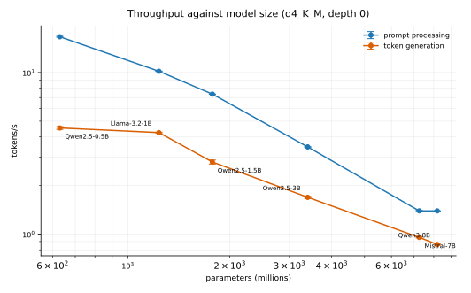
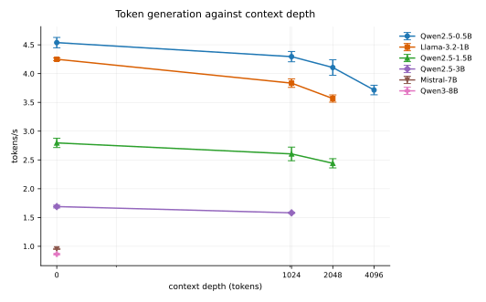
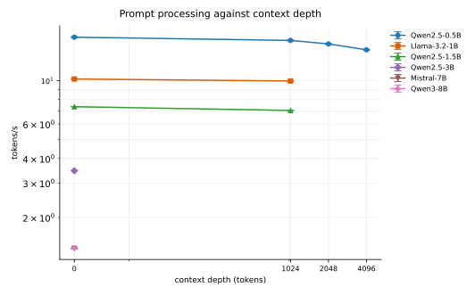
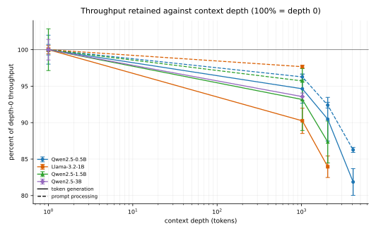
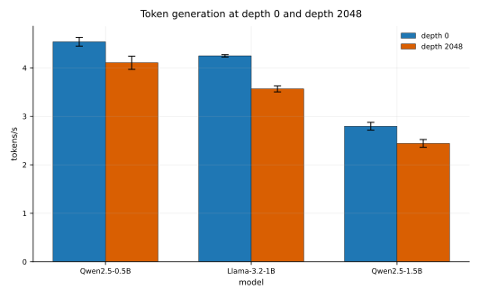

# llama.cpp on Mac Pro 3,1: model size and context depth

Second sweep on the same machine as `docs/build-macpro31.md`: six models from 0.5B to 8B, at
context depths up to 4096 tokens. Build, portability fixes and the GPU situation are in that
document; this one reports measurements.

## Hardware

| Item | Value |
|---|---|
| CPU | 2x Xeon X5482 (Harpertown), 8 cores, SSE4.1, no AVX |
| RAM | 24 GiB |
| OS | OS X 10.11.6, Darwin 15.6 |
| Backend | CPU only, 8 threads |

## Method

- `llama-bench` from the build produced by `scripts/build-macpro31.sh`; batch and ubatch at their
  defaults, Flash Attention `auto`, 8 threads.
- Six models, all Q4_K_M so that size is the main variable: Qwen2.5-0.5B, Llama-3.2-1B,
  Qwen2.5-1.5B, Qwen2.5-3B, Mistral-7B, Qwen3-8B.
- A prompt processing test is 128 tokens, a token generation test is 32 tokens. Depths of 1024 and
  above build a context of that many tokens before the test runs.
- **Interleaved schedule.** The run list is built as randomized rounds: each round holds every
  selected condition once, the order inside a round is shuffled, and no condition is ever placed
  next to itself, including across a round boundary. Every condition therefore appears once in each
  slice of the sweep, so a slow change on the machine is spread evenly across all conditions instead
  of biasing one. The realized order is committed as `macpro31/bench-scale-plan.tsv`.
- **A quiet machine before every run.** Backup and indexing jobs make these numbers meaningless, so
  before each individual run the script waits until the CPU used by `rsync`, `mds`, `mds_stores`,
  `mdworker`, `MRT` and `fseventsd` is under 20 percent, then starts the run. A run never begins
  while those jobs are working.
- Repeats: 4 per condition in the size sweep, 3 per condition in the depth sweep. Each point is the
  mean of its runs and the error bar is one sample standard deviation, so bars show run-to-run
  spread rather than a confidence interval for the mean.
- Deep contexts cost real time: `llama-bench` rebuilds the depth context once for the prompt test and
  again for the generation test, so a 4096-token condition pays two 4096-token prefills. Where that
  is minutes of work, only the test of interest was run: generation only at 2048 and 4096 for the
  smaller models, and prompt processing at depth measured separately for Qwen2.5-0.5B. Each chart
  states which depths it covers.
- The depth-0 baseline for the deeper points comes from the size sweep, which measures the same
  models at depth 0 with 4 runs.

## Throughput against model size



| model | params | n | prompt t/s | sd | generation t/s | sd |
|---|---|---|---|---|---|---|
| Qwen2.5-0.5B | 0.63B | 4 | 16.64 | 0.12 | 4.54 | 0.09 |
| Llama-3.2-1B | 1.24B | 4 | 10.18 | 0.03 | 4.25 | 0.02 |
| Qwen2.5-1.5B | 1.78B | 4 | 7.35 | 0.00 | 2.80 | 0.08 |
| Qwen2.5-3B | 3.40B | 4 | 3.46 | 0.00 | 1.69 | 0.02 |
| Mistral-7B | 7.25B | 4 | 1.39 | 0.01 | 0.95 | 0.01 |
| Qwen3-8B | 8.19B | 4 | 1.39 | 0.00 | 0.86 | 0.01 |

## Token generation against context depth



| model | depth | n | t/s | sd | retained |
|---|---|---|---|---|---|
| Qwen2.5-0.5B | 0 | 4 | 4.54 | 0.09 | 100.0% |
| Qwen2.5-0.5B | 1024 | 3 | 4.29 | 0.09 | 94.6% |
| Qwen2.5-0.5B | 2048 | 3 | 4.11 | 0.14 | 90.5% |
| Qwen2.5-0.5B | 4096 | 3 | 3.71 | 0.08 | 81.9% |
| Llama-3.2-1B | 0 | 4 | 4.25 | 0.02 | 100.0% |
| Llama-3.2-1B | 1024 | 3 | 3.83 | 0.07 | 90.2% |
| Llama-3.2-1B | 2048 | 3 | 3.57 | 0.06 | 83.9% |
| Qwen2.5-1.5B | 0 | 4 | 2.80 | 0.08 | 100.0% |
| Qwen2.5-1.5B | 1024 | 3 | 2.60 | 0.12 | 93.2% |
| Qwen2.5-1.5B | 2048 | 3 | 2.44 | 0.08 | 87.3% |
| Qwen2.5-3B | 0 | 4 | 1.69 | 0.02 | 100.0% |
| Qwen2.5-3B | 1024 | 3 | 1.58 | 0.01 | 93.6% |

## Prompt processing against context depth



| model | depth | n | t/s | sd | retained |
|---|---|---|---|---|---|
| Qwen2.5-0.5B | 0 | 4 | 16.64 | 0.12 | 100.0% |
| Qwen2.5-0.5B | 1024 | 3 | 16.02 | 0.07 | 96.3% |
| Qwen2.5-0.5B | 2048 | 3 | 15.38 | 0.06 | 92.4% |
| Qwen2.5-0.5B | 4096 | 3 | 14.36 | 0.06 | 86.3% |
| Llama-3.2-1B | 1024 | 3 | 9.95 | 0.02 | 97.7% |
| Qwen2.5-1.5B | 1024 | 3 | 7.04 | 0.01 | 95.7% |

## Throughput retained



Solid lines are token generation, dashed lines are prompt processing, and 100 percent is each
model's own depth-0 figure.

## Depth 0 against depth 2048



## What the numbers say

- **Prompt processing is compute bound, and this CPU delivers a nearly constant number of
  operations per second.** Throughput falls from 16.64 to 1.39 tokens/s across a 13x range of model
  size. Multiply tokens/s by two operations per parameter and the product stays in one band:

  | model | params | prompt t/s | effective GFLOP/s |
  |---|---|---|---|
  | Qwen2.5-0.5B | 0.63B | 16.64 | 21.0 |
  | Llama-3.2-1B | 1.24B | 10.18 | 25.2 |
  | Qwen2.5-1.5B | 1.78B | 7.35 | 26.2 |
  | Qwen2.5-3B | 3.40B | 3.46 | 23.5 |
  | Mistral-7B | 7.25B | 1.39 | 20.2 |
  | Qwen3-8B | 8.19B | 1.39 | 22.8 |

  About 23 GFLOP/s, so a rough rule here is `prompt tokens/s ~ 23 / (2 x params in billions)`.
- **Generation is bandwidth bound.** Reading every weight once per token dominates, so throughput
  tracks weight bytes rather than arithmetic. At Q4_K_M (about 0.6 bytes per weight) the effective
  read bandwidth is roughly 3 to 4 GB/s for the models from 1B up, and generation throughput is
  close to `3.5 GB/s / (params x 0.6 bytes)`. Qwen2.5-0.5B beats that projection because at 0.63B
  the per-token overhead is a larger share than the streaming.
- **Between 0.5B and 1B, generation barely moves** (4.54 against 4.25 tokens/s) even though prompt
  processing halves. That is the expected split: the smaller model is limited by fixed per-token
  overheads, the larger one by bytes read.
- **Depth hurts generation more than prompt processing.** At 1024 tokens, generation retains 90 to
  95 percent while prompt processing retains 96 to 98 percent. At 4096 on Qwen2.5-0.5B, generation
  is down to 82 percent while prompt processing holds 86 percent. The attention pass reads the KV
  cache on every generated token, and that read grows with the context, so the cost lands on
  generation; prompt processing pays only for the longer attention over the incoming prompt.
- **This machine's practical ceiling is the 0.5B to 1.5B range.** 2.8 to 4.5 tokens/s is usable for
  interactive work. Qwen2.5-3B at 1.69 tokens/s is marginal, and Mistral-7B at 0.95 and Qwen3-8B at
  0.86 tokens/s are effectively batch-only. Prompt processing at 1.39 tokens/s for a 7B or 8B model
  means a 1000-token prompt needs about 12 minutes before the first token.
- The two sweeps agree where they overlap: Qwen2.5-0.5B prompt processing at depth 1024 was 16.04
  tokens/s in the earlier sweep and 16.02 here, and Llama-3.2-1B was 9.96 against 9.95. The
  interleaved schedule and the idle gate did not move the numbers, which is the point.

## Reproducing the numbers

```
scripts/build-macpro31.sh
scripts/bench-macpro31.sh large                      # about 5 hours on this machine
python3 scripts/plot-macpro31-large.py \
    docs/macpro31/bench-scale.jsonl docs/macpro31/bench-depth.jsonl docs/macpro31
```

`bench-macpro31.sh` needs `MODELS_DIR` to hold the six GGUF files it names. It is resumable: runs
already listed in the done file are skipped, so an interrupted sweep continues where it stopped.
