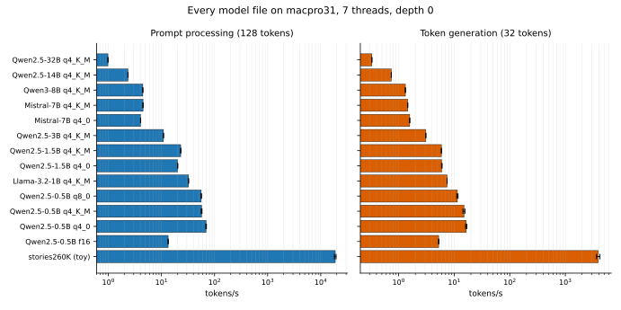
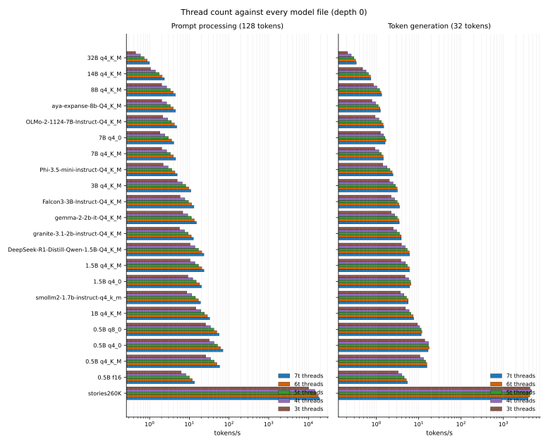

# llama.cpp on Mac Pro 3,1: model size and context depth

Second sweep on the same machine as `docs/build-macpro31.md`: six models from 0.5B to 8B at
context depths up to 4096 tokens, plus one pass over every GGUF file on the machine, which includes
two larger models (14B and 32B) added for this exercise. Build, portability fixes and the GPU
situation are in that document; this one reports measurements.

## Hardware

| Item | Value |
|---|---|
| CPU | 2x Xeon X5482 (Harpertown), 8 cores, SSE4.1, no AVX |
| RAM | 32 GiB |
| OS | OS X 10.11.6, Darwin 15.6 |
| Backend | CPU only, **7 threads** |

## Method

- `llama-bench` from the build produced by `scripts/build-macpro31.sh`; batch and ubatch at their
  defaults, Flash Attention `auto`, 7 threads. Seven rather than eight because eight worker
  threads on eight cores leave no headroom and generation collapses to about a third on this
  machine when anything else is runnable; the measurement is in
  [`build-macpro31-perf.md`](build-macpro31-perf.md) and repeated in `build-macpro31.md`.
- Six models, all Q4_K_M so that size is the main variable: Qwen2.5-0.5B, Llama-3.2-1B,
  Qwen2.5-1.5B, Qwen2.5-3B, Mistral-7B, Qwen3-8B.
- A prompt processing test is 128 tokens, a token generation test is 32 tokens. Depths of 1024 and
  above build a context of that many tokens before the test runs.
- **Interleaved schedule.** The run list is built as randomized rounds: each round holds every
  selected condition once, the order inside a round is shuffled, and no condition is ever placed
  next to itself, including across a round boundary. Every condition therefore appears once in each
  slice of the sweep, so a slow change on the machine is spread evenly across all conditions instead
  of biasing one. The realized order is committed as `macpro31/bench-all-plan.tsv`.
- **A quiet machine before every run.** Before each individual run the script waits until the CPU
  used by `rsync`, `backupd`, `mds`, `mdworker`, `MRT` and `fseventsd` is under 20 percent and the
  1-minute load average is under 12, then starts the run. The load limit matters as much as the CPU
  one on this machine: Spotlight indexes several external volumes and Time Machine periodically
  thins a 5.5 TiB backup volume, and both put the system into I/O wait without showing high CPU.
- Repeats: 4 per condition in the size sweep, 3 per condition in the depth sweep. Each point is the
  mean of its runs and the error bar is one sample standard deviation, so bars show run-to-run
  spread rather than a confidence interval for the mean.
- Deep contexts cost real time: `llama-bench` rebuilds the depth context once for the prompt test and
  again for the generation test, so a 4096-token condition pays two 4096-token prefills. Where that
  is minutes of work, only the test of interest was run: generation only at 2048 and 4096 for the
  smaller models, and prompt processing at depth measured separately for Qwen2.5-0.5B. Each chart
  states which depths it covers.
- The depth-0 baseline for the deeper points comes from the size sweep, which measures the same
  models at depth 0 with 4 runs.
- **The two larger models are a separate pass.** Qwen2.5-14B and Qwen2.5-32B (Q4_K_M, 8.98 and
  19.85 GB) are not part of the six-model comparison: they were measured with the same build,
  threads and gate, but with `MODELS_DIR` pointing at a directory holding only those two, so they
  could be added without repeating the twelve files the main sweep had already measured.
- **Two further full sweeps were run, at 6 and 4 threads**, same seed, same schedule and same
  build, so the datasets differ only in the thread count. 7 threads remains the baseline everywhere
  in this document; the comparison is in "What thread count changes" below, and the records are the
  `macpro31/bench-*-6t.jsonl` and `macpro31/bench-*-4t.jsonl` files.

## Throughput against model size


| model | params | n | prompt t/s | sd | generation t/s | sd |
|---|---|---|---|---|---|---|
| Qwen2.5-0.5B | 0.63B | 4 | 56.88 | 0.88 | 14.96 | 0.24 |
| Llama-3.2-1B | 1.24B | 4 | 32.38 | 0.07 | 7.45 | 0.02 |
| Qwen2.5-1.5B | 1.78B | 4 | 22.98 | 0.07 | 5.81 | 0.06 |
| Qwen2.5-3B | 3.40B | 4 | 10.92 | 0.03 | 3.10 | 0.01 |
| Mistral-7B | 7.25B | 4 | 4.47 | 0.05 | 1.45 | 0.00 |
| Qwen3-8B | 8.19B | 4 | 4.45 | 0.01 | 1.32 | 0.01 |

## Token generation against context depth


| model | depth | n | t/s | sd | retained |
|---|---|---|---|---|---|
| Qwen2.5-0.5B | 0 | 4 | 14.96 | 0.24 | 100.0% |
| Qwen2.5-0.5B | 1024 | 3 | 12.08 | 0.08 | 80.8% |
| Qwen2.5-0.5B | 2048 | 3 | 10.09 | 0.11 | 67.5% |
| Qwen2.5-0.5B | 4096 | 3 | 7.77 | 0.11 | 52.0% |
| Llama-3.2-1B | 0 | 4 | 7.45 | 0.02 | 100.0% |
| Llama-3.2-1B | 1024 | 3 | 6.17 | 0.01 | 82.8% |
| Llama-3.2-1B | 2048 | 3 | 5.37 | 0.02 | 72.1% |
| Qwen2.5-1.5B | 0 | 4 | 5.81 | 0.06 | 100.0% |
| Qwen2.5-1.5B | 1024 | 3 | 4.76 | 0.04 | 81.9% |
| Qwen2.5-1.5B | 2048 | 3 | 4.11 | 0.05 | 70.8% |
| Qwen2.5-3B | 0 | 4 | 3.10 | 0.01 | 100.0% |
| Qwen2.5-3B | 1024 | 3 | 2.55 | 0.06 | 82.5% |
| Mistral-7B | 0 | 4 | 1.45 | 0.00 | 100.0% |
| Qwen3-8B | 0 | 4 | 1.32 | 0.01 | 100.0% |

## Prompt processing against context depth


| model | depth | n | t/s | sd | retained |
|---|---|---|---|---|---|
| Qwen2.5-0.5B | 0 | 4 | 56.88 | 0.88 | 100.0% |
| Qwen2.5-0.5B | 1024 | 3 | 52.22 | 0.16 | 91.8% |
| Qwen2.5-0.5B | 2048 | 3 | 48.04 | 0.15 | 84.5% |
| Qwen2.5-0.5B | 4096 | 3 | 40.97 | 0.20 | 72.0% |
| Llama-3.2-1B | 0 | 4 | 32.38 | 0.07 | 100.0% |
| Llama-3.2-1B | 1024 | 3 | 28.82 | 0.03 | 89.0% |
| Qwen2.5-1.5B | 0 | 4 | 22.98 | 0.07 | 100.0% |
| Qwen2.5-1.5B | 1024 | 3 | 20.10 | 0.03 | 87.5% |
| Qwen2.5-3B | 0 | 4 | 10.92 | 0.03 | 100.0% |
| Mistral-7B | 0 | 4 | 4.47 | 0.05 | 100.0% |
| Qwen3-8B | 0 | 4 | 4.45 | 0.01 | 100.0% |

## Throughput retained


Solid lines are token generation, dashed lines are prompt processing, and 100 percent is each
model's own depth-0 figure.

## Depth 0 against depth 2048


## Every model file on the machine

`scripts/bench-macpro31.sh coverage` walks every `*.gguf` in `MODELS_DIR` at depth 0, so the chart
and table below answer "how does each file actually run" rather than following the six-model
comparison above. The duplicates that differ only in quantization are included on purpose: they
are what is on the disk.



| model | prompt t/s | sd | generation t/s | sd |
|---|---|---|---|---|
| Qwen2.5-0.5B q4_K_M | 56.95 | 1.01 | 14.98 | 0.61 |
| Qwen2.5-0.5B q4_0 | 69.36 | 0.91 | 16.42 | 0.44 |
| Qwen2.5-0.5B q8_0 | 56.05 | 0.82 | 11.42 | 0.31 |
| Qwen2.5-0.5B f16 | 13.36 | 0.07 | 5.25 | 0.03 |
| Llama-3.2-1B q4_K_M | 32.38 | 0.02 | 7.46 | 0.00 |
| Qwen2.5-1.5B q4_K_M | 23.04 | 0.05 | 5.89 | 0.02 |
| Qwen2.5-1.5B q4_0 | 20.21 | 0.06 | 5.99 | 0.07 |
| Qwen2.5-3B q4_K_M | 10.91 | 0.01 | 3.09 | 0.01 |
| Mistral-7B q4_K_M | 4.49 | 0.00 | 1.46 | 0.00 |
| Mistral-7B q4_0 | 4.04 | 0.00 | 1.58 | 0.00 |
| Qwen3-8B q4_K_M | 4.46 | 0.00 | 1.32 | 0.00 |
| Qwen2.5-14B q4_K_M | 2.34 | 0.01 | 0.74 | 0.00 |
| Qwen2.5-32B q4_K_M | 0.98 | 0.00 | 0.33 | 0.00 |
| stories260K (toy) | 18758.50 | 681.55 | 3901.97 | 279.39 |

`stories260K` is a 1.1 MB toy model included because it is on the disk; its numbers only show that
the harness itself has no fixed overhead worth worrying about.

## What thread count changes

The sweep was repeated at 6 and at 4 threads — same seed, same randomized schedule, same build — so
the datasets differ in exactly one number. Raw records: `macpro31/bench-*-6t.jsonl` and
`macpro31/bench-*-4t.jsonl`.



| model | test | 7t | 6t | 4t | 6t/7t | 4t/7t |
|---|---|---|---|---|---|---|
| stories260K | prefill | 18758.50 | 17575.93 | 14255.87 | 94% | 76% |
| stories260K | generation | 3901.97 | 4259.20 | 4564.33 | 109% | 117% |
| 0.5B q4_0 | prefill | 69.36 | 61.33 | 41.62 | 88% | 60% |
| 0.5B q4_0 | generation | 16.42 | 17.76 | 15.69 | 108% | 96% |
| 0.5B q4_K_M | prefill | 56.95 | 50.51 | 34.23 | 89% | 60% |
| 0.5B q4_K_M | generation | 14.98 | 15.91 | 12.29 | 106% | 82% |
| 0.5B q8_0 | prefill | 56.05 | 49.80 | 34.02 | 89% | 61% |
| 0.5B q8_0 | generation | 11.42 | 12.12 | 10.38 | 106% | 91% |
| 0.5B f16 | prefill | 13.36 | 11.82 | 8.17 | 88% | 61% |
| 0.5B f16 | generation | 5.25 | 4.95 | 3.96 | 94% | 75% |
| 1B q4_K_M | prefill | 32.38 | 28.66 | 19.37 | 89% | 60% |
| 1B q4_K_M | generation | 7.46 | 7.39 | 5.71 | 99% | 77% |
| 1.5B q4_0 | prefill | 20.21 | 18.12 | 12.18 | 90% | 60% |
| 1.5B q4_0 | generation | 5.99 | 6.56 | 5.78 | 109% | 96% |
| 1.5B q4_K_M | prefill | 23.04 | 20.64 | 13.71 | 90% | 60% |
| 1.5B q4_K_M | generation | 5.89 | 5.98 | 4.66 | 102% | 79% |
| 3B q4_K_M | prefill | 10.91 | 9.68 | 6.58 | 89% | 60% |
| 3B q4_K_M | generation | 3.09 | 3.09 | 2.44 | 100% | 79% |
| 7B q4_K_M | prefill | 4.49 | 3.94 | 2.68 | 88% | 60% |
| 7B q4_K_M | generation | 1.46 | 1.41 | 1.15 | 97% | 79% |
| 7B q4_0 | prefill | 4.04 | 3.57 | 2.42 | 88% | 60% |
| 7B q4_0 | generation | 1.58 | 1.68 | 1.47 | 106% | 93% |
| 8B q4_K_M | prefill | 4.46 | 3.95 | 2.66 | 89% | 60% |
| 8B q4_K_M | generation | 1.32 | 1.31 | 1.03 | 99% | 78% |
| 14B q4_K_M | prefill | 2.34 | 2.06 | 1.40 | 88% | 60% |
| 14B q4_K_M | generation | 0.74 | 0.72 | 0.57 | 98% | 78% |
| 32B q4_K_M | prefill | 0.98 | 0.87 | 0.58 | 88% | 59% |
| 32B q4_K_M | generation | 0.33 | 0.32 | 0.25 | 97% | 77% |

- **Prefill scales with the core count and nothing else.** 88 to 90 percent of the 7-thread rate at 6
  threads and 59 to 61 percent at 4, against thread ratios of 86 and 57 percent. It is flat from
  0.5B to 32B, which is what "compute bound" means concretely.
- **Six threads is the sweet spot on this machine.** Generation at 6 threads is 97 to 109 percent of
  the 7-thread figure: at parity or slightly better almost everywhere, and clearly better on the
  small `q4_0`/`q8_0` models (106-109 percent). Seven worker threads on eight cores leave almost no
  slack, so a barrier waits whenever anything else runs; six leaves two cores and the memory-bound
  generation loop never stalls. You keep 88 percent of prefill and lose no generation at all, while
  two cores stay free for the desktop.
- **At 4 threads generation depends on the format, because the memory bus starts to matter.** `q4_0`
  and `q8_0` hold 91 to 96 percent — four threads already nearly saturate bandwidth — while
  `q4_K_M` keeps 77 to 82 percent and `f16` 75 percent. The K-quant kernels do still gain from extra
  threads.
- **Depth costs a little more at fewer threads.** For Qwen2.5-0.5B the prefill ratio falls from 60
  percent of the 7-thread rate at depth 0 to 53 percent at 4096, and generation from 87 to 76
  percent: the attention pass over the KV cache is partly compute, so it tracks the thread count
  too.
- `stories260K` reads 109 and 117 percent on generation, which is meaningless: sub-millisecond runs
  on a 1.1 MB toy model.
- The 7-thread figures stay the baseline in the rest of this document. This section is a comparison,
  not a replacement; `build-macpro31-perf.md` explains the 8-thread collapse that makes 8 the one
  count to avoid.

## What the numbers say## What the numbers say

- **Prompt processing delivers a nearly constant number of operations per second.** Throughput
  falls from 56.9 to 4.45 tokens/s across a 13x range of model size, and the product with two
  operations per parameter stays in one band:

  | model | params | prompt t/s | effective GFLOP/s |
  |---|---|---|---|
  | Qwen2.5-0.5B | 0.63B | 56.88 | 71.7 |
  | Llama-3.2-1B | 1.24B | 32.38 | 80.0 |
  | Qwen2.5-1.5B | 1.78B | 22.98 | 81.7 |
  | Qwen2.5-3B | 3.40B | 10.92 | 74.2 |
  | Mistral-7B | 7.25B | 4.47 | 64.7 |
  | Qwen3-8B | 8.19B | 4.45 | 73.0 |

  About 65 to 82 GFLOP/s, so the rough rule here is `prompt tokens/s ~ 75 / (2 x params in
  billions)`. The pre-SSSE3 builds on this machine managed 21-26 GFLOP/s, so the kernel work is
  most of the difference.
- **Generation is bandwidth bound and sits at the measured ceiling.** Reading every weight once
  per token, the effective read rate is 7.3 GB/s at 0.5B, 6.0 at 1B, 6.5 at 1.5B, 6.5 at 3B, 6.4
  at 7B, 6.7 at 8B, 6.6 at 14B and 6.6 at 32B, against 7.14 GB/s for a pure 8-thread streaming read:
  84 to 102 percent of it. That flatness over a 40x range of model size, 0.49 GB to 19.85 GB, is
  the whole story of generation on this machine: throughput tracks weight bytes, so the 32B model
  generates at about a quarter the rate of the 8B one.
- **Depth hurts generation much more than prompt processing.** At 1024 tokens generation retains
  76 to 83 percent while prompt processing retains 87 to 92 percent. At 4096 on Qwen2.5-0.5B,
  generation is down to 52 percent while prompt processing holds 72 percent. The attention pass
  reads the KV cache on every generated token, and that read grows with the context; prompt
  processing pays it once.
- **Format matters less than it used to.** With SSSE3 kernels for both, q4_0 leads q4_K_M by 21
  percent on 0.5B prefill but is level or slightly behind on the larger models (1.5B: 20.2 against
  23.0). Generation is within a few percent either way, and q4_0 wins at 7B (1.58 against 1.46)
  because the file is 7 percent smaller. The old 4.4x penalty for q4_K_M is gone.
- **This machine's practical ceiling is the 1.5B to 3B range.** 4.8 to 5.9 tokens/s is usable for
  interactive work, and 2.55 at 3B with a 1024-token context is marginal but alive. Mistral-7B at
  1.45 and Qwen3-8B at 1.32 tokens/s are batch-only. Prompt processing at 4.45 tokens/s for a 7B or
  8B model means a 1000-token prompt needs about four minutes before the first token, against the
  12 minutes the OpenMP build took.
- **Beyond 8B the machine still works, but leaves interactive use behind.** The 14B generates at
  0.74 tokens/s and the 32B at 0.33, with prefill of 2.34 and 0.98 tokens/s, so a 1000-token prompt
  costs about 7 minutes on the 14B and 17 minutes on the 32B before the first token, and 32
  generated tokens cost 43 and 97 seconds. The 32B fits in 32 GiB only because llama.cpp maps the
  weights from disk; there is no room for a large KV cache beside it, which is why it was measured
  at depth 0 only.
- The two sweeps agree where they overlap: Qwen2.5-0.5B prompt processing at depth 1024 was 51.84
  in the context sweep and 52.22 in the depth sweep, and Llama-3.2-1B was 28.81 against 28.82.
  Different phases, same answer.

## Reproducing the numbers

```
scripts/build-macpro31.sh
MODELS_DIR=~/models THREADS=7 scripts/bench-macpro31.sh large    # about two hours on this machine
MODELS_DIR=~/models THREADS=7 scripts/bench-macpro31.sh coverage # every GGUF, depth 0
python3 scripts/plot-macpro31-large.py \
    docs/macpro31/bench-scale.jsonl docs/macpro31/bench-depth.jsonl docs/macpro31
MODELS_DIR=~/models-large THREADS=7 scripts/bench-macpro31.sh coverage   # the 14B and 32B pass
python3 scripts/plot-macpro31-coverage.py \
    docs/macpro31/bench-coverage.jsonl docs/macpro31/bench-coverage-xl.jsonl docs/macpro31

# the same sweep at 6 and at 4 threads, then the comparison
MODELS_DIR=~/models THREADS=6 OUT=~/bench-macpro31-t6.jsonl scripts/bench-macpro31.sh all
MODELS_DIR=~/models THREADS=4 OUT=~/bench-macpro31-t4.jsonl scripts/bench-macpro31.sh all
python3 scripts/plot-macpro31-threads.py docs/macpro31 \
    7t=docs/macpro31/bench-coverage.jsonl,docs/macpro31/bench-coverage-xl.jsonl \
    6t=docs/macpro31/bench-coverage-6t.jsonl \
    4t=docs/macpro31/bench-coverage-4t.jsonl
```

`bench-macpro31.sh` needs `MODELS_DIR` to hold the GGUF files it names. It is resumable: runs
already listed in the done file are skipped, so an interrupted sweep continues where it stopped.
