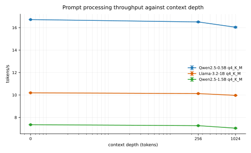
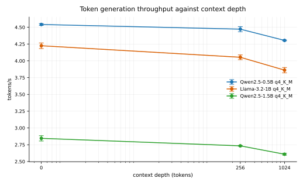
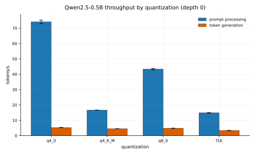
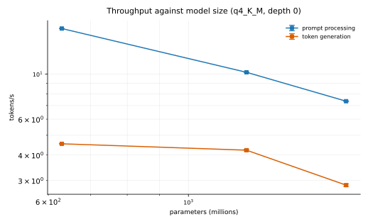

# llama.cpp on Mac Pro 3,1 (OS X 10.11)

This branch makes llama.cpp build and run on a Mac Pro 3,1 with OS X 10.11.6 El Capitan, using
the CPU backend. GPU acceleration is not possible on this machine; the evidence is below, and the
measured throughput of the CPU backend is at the end.

## Hardware and software

| Item | Value |
|---|---|
| CPU | 2x Xeon X5482 (Harpertown), 8 cores, SSE4.1, no AVX |
| RAM | 24 GiB |
| GPU | NVIDIA Quadro 4000 (Fermi GF100), 2 GiB |
| OS | OS X 10.11.6, Darwin 15.6 |
| Compiler | GCC 10.2.0 (MacPorts), because Apple clang cannot build this tree |
| CMake / Ninja | 3.19.1 / 1.10.2 |

## Why GCC 10 and not Apple clang

Apple clang 8.0 (Xcode 8.2) rejects `-std=c++17`, and libc++ marks `std::filesystem` as
`unavailable: introduced in macOS 10.15`, so this tree cannot be built with it on El Capitan:

```
.../include/c++/v1/filesystem:738:24: error: 'path' is unavailable: introduced in macOS 10.15
```

GCC 10 ships its own libstdc++, which implements C++17 and `std::filesystem` with no deployment
target restriction. Two consequences follow from using it:

- The Accelerate framework headers (`Accelerate.h` -> `vecLib.h` -> `vBasicOps.h`) use vector
  types that GCC rejects, so `GGML_ACCELERATE` must stay off. `ggml-blas` includes
  `Accelerate.h` too, so the BLAS backend is off as well. This costs almost nothing: `ggml-blas`
  only accelerates F32 tensors, so it never applies to quantized models.
- The Metal backend cannot compile at all: the 10.11 Foundation headers use Objective-C
  generics and nullability, which GCC 10 does not support.

## Changes in this branch

- `ggml/src/ggml.c`: `ggml_time_ms()` and `ggml_time_us()` call `clock_gettime(CLOCK_MONOTONIC)`,
  which only exists from macOS 10.12. On Apple platforms whose headers do not define
  `CLOCK_MONOTONIC` they now use `mach_absolute_time()` instead. Without this the file does not
  compile on El Capitan: `error: 'CLOCK_MONOTONIC' undeclared`.
- `tests/test-tiled-mulmat.cpp`: the same missing `clock_gettime`. It now uses `ggml_time_us()`,
  which removes the timer `#ifdef` and the `windows.h` and `time.h` includes.
- `ggml/CMakeLists.txt` and `docs/build.md`: Metal is no longer on by default for Darwin < 22,
  because the backend relies on Metal 3 era APIs that older SDKs do not declare and older
  runtimes do not implement. Pass `-DGGML_METAL=ON` to build it anyway.

## GPU acceleration: not available on this machine

No GPU backend in this tree can run on a Mac Pro 3,1. This is a property of the hardware and the
OS, not of the build:

| Backend | Why it cannot run |
|---|---|
| Metal | `MTLCreateSystemDefaultDevice()` returns nil. The Quadro 4000 is Fermi (GF100), and Metal needs Kepler or newer on NVIDIA. The backend also needs Metal 3 era APIs that 10.11 does not have. |
| Vulkan | macOS has no native Vulkan and MoltenVK is built on Metal. There is no Vulkan loader on the machine: `Could NOT find Vulkan (missing: Vulkan_LIBRARY Vulkan_INCLUDE_DIR)`. |
| CUDA | The installed toolkits are 4.1 and 7.0. `ggml-cuda` needs CUDA 11 or newer and compute capability 5.0 or newer; Fermi is 2.0, and CUDA 8.0 was the last release supporting macOS. |
| OpenCL | The backend targets OpenCL 3.0 with Adreno kernels. The Quadro 4000 offers OpenCL 1.1. |
| SYCL, HIP, MUSA, CANN, Hexagon | Vendor platforms that do not exist for macOS. |

So there is one build and not two. The GPU still drives the display; it just cannot compute here.

## Building

```
sudo port install gcc10 cmake ninja
scripts/build-macpro31.sh          # build build-macpro31-cpu
scripts/build-macpro31.sh check    # build, then run the tests that check CPU kernels
```

Binaries land in `build-macpro31-cpu/bin`.

## Verification on this machine

- `test-quantize-fns`, `test-gguf` (101/101), `test-sampling` and `test-tiled-mulmat` pass.
  `test-tiled-mulmat` reports `max_err: 0.000000` for every quantized type, so the SSE4.1
  kernels agree with the reference implementation.
- `test-backend-ops` skips the CPU backend by design and therefore proves nothing here.
- Greedy generation with Qwen2.5-0.5B-Instruct Q4_K_M answers `The capital of France is Paris.`
- The HTTP server answers `/health` with `{"status":"ok"}` and returns a correct `/completion`.

## Measured throughput

Every number below comes from `scripts/bench-macpro31.sh`, which is committed so the sweep can be
repeated. The raw llama-bench records of each run are in `docs/macpro31/bench-context.jsonl` and
`docs/macpro31/bench-quant.jsonl`; `scripts/plot-macpro31.py` turns them into the charts and
`docs/macpro31/results.csv`.

### Method

- `llama-bench`, CPU backend, 8 threads, batch and ubatch at their defaults, Flash Attention `auto`.
- A prompt processing test is 128 tokens, a token generation test is 32 tokens.
- Context depth is swept with `-d`: llama-bench fills the context with that many tokens first, then
  runs the test. It builds the context once for the prompt test and again for the generation test,
  so wall time grows with roughly twice the depth prefill cost.
- Each repetition is a separate `llama-bench` process. The full run list is shuffled with a fixed
  seed before it starts, so drift on the machine (thermal, background work) spreads across every
  model and depth instead of landing on whichever condition ran first. The committed
  `docs/macpro31/bench-plan.tsv` is that order.
- Four independent processes per condition. Error bars and the `sd` column are plus or minus one
  sample standard deviation of those four values, so they show run-to-run spread. They are not a
  confidence interval for the mean, and they do not cover conditions the sweep did not vary.
- Spotlight indexing ran throughout and held about 85% of one core. That noise is inside the error
  bars rather than corrected away. `.metadata_never_index` markers were added to the model and
  build directories so it does not grow.

### Prompt processing against context depth



| model | depth | n | tokens/s | sd |
|---|---|---|---|---|
| Qwen2.5-0.5B q4_K_M | 0 | 4 | 16.72 | 0.01 |
| Qwen2.5-0.5B q4_K_M | 256 | 4 | 16.51 | 0.04 |
| Qwen2.5-0.5B q4_K_M | 1024 | 4 | 16.04 | 0.06 |
| Llama-3.2-1B q4_K_M | 0 | 4 | 10.19 | 0.01 |
| Llama-3.2-1B q4_K_M | 256 | 4 | 10.12 | 0.02 |
| Llama-3.2-1B q4_K_M | 1024 | 4 | 9.96 | 0.01 |
| Qwen2.5-1.5B q4_K_M | 0 | 4 | 7.35 | 0.01 |
| Qwen2.5-1.5B q4_K_M | 256 | 4 | 7.27 | 0.02 |
| Qwen2.5-1.5B q4_K_M | 1024 | 4 | 7.04 | 0.01 |

### Token generation against context depth



| model | depth | n | tokens/s | sd |
|---|---|---|---|---|
| Qwen2.5-0.5B q4_K_M | 0 | 4 | 4.54 | 0.01 |
| Qwen2.5-0.5B q4_K_M | 256 | 4 | 4.47 | 0.04 |
| Qwen2.5-0.5B q4_K_M | 1024 | 4 | 4.30 | 0.01 |
| Llama-3.2-1B q4_K_M | 0 | 4 | 4.22 | 0.04 |
| Llama-3.2-1B q4_K_M | 256 | 4 | 4.05 | 0.04 |
| Llama-3.2-1B q4_K_M | 1024 | 4 | 3.86 | 0.04 |
| Qwen2.5-1.5B q4_K_M | 0 | 4 | 2.85 | 0.04 |
| Qwen2.5-1.5B q4_K_M | 256 | 4 | 2.73 | 0.01 |
| Qwen2.5-1.5B q4_K_M | 1024 | 4 | 2.61 | 0.01 |

### Quantization at depth 0

All four are the same Qwen2.5-0.5B model, so this isolates the quantization format.



| quantization | test | n | tokens/s | sd |
|---|---|---|---|---|
| q4_0 | prompt | 4 | 74.14 | 1.16 |
| q4_0 | generation | 4 | 5.27 | 0.04 |
| q4_K_M | prompt | 4 | 16.67 | 0.03 |
| q4_K_M | generation | 4 | 4.55 | 0.02 |
| q8_0 | prompt | 4 | 43.34 | 0.45 |
| q8_0 | generation | 4 | 4.83 | 0.08 |
| f16 | prompt | 4 | 14.89 | 0.09 |
| f16 | generation | 4 | 3.37 | 0.03 |

### Throughput against model size



## What the numbers say

- **Prompt processing is compute bound and scales with parameter count.** Q4_K_M gives 16.72,
  10.19 and 7.35 tokens/s for 0.63B, 1.2B and 1.8B. Generation is not: 0.63B and 1.2B generate at
  4.54 and 4.22 tokens/s, because a single token pass is dominated by reading the weights, and
  memory bandwidth is the limit, not arithmetic units.
- **Context costs generation throughput, and prompt processing barely notices.** From depth 0 to
  1024, generation drops 5.3% on 0.5B, 8.5% on 1B and 8.4% on 1.5B, while prompt processing drops
  only 2 to 4%. Longer contexts cost more per token because the attention pass reads the KV cache
  every step, and that read grows with the context.
- **Q4_0 is the fastest format for prompt processing on this CPU, by 4.4x over Q4_K_M.** That is
  not a general llama.cpp result, it is what happens on a CPU without AVX. `Q4_0` has a dedicated
  SSSE3 dot product kernel (`ggml_vec_dot_q4_0_q8_0` in
  `ggml/src/ggml-cpu/arch/x86/quants.c`), and SSE4.1 includes SSSE3, so it is used. The K-quant
  kernels have only AVX2 and AVX versions plus a generic fallback, so on Harpertown
  `ggml_vec_dot_q4_K_q8_K` ends in `ggml_vec_dot_q4_K_q8_K_generic`, a scalar loop. The repacked
  matmul kernels do not rescue it: `ggml_repack_get_optimal_repack_type` returns repacked traits
  only for AVX2, SVE, NEON with dot product, VXE or RISC-V, and this CPU has none of them.
- **Generation is much less sensitive to the format than prompt processing**, because it is
  bandwidth bound: 4.55 to 5.27 tokens/s across q4_0, q4_K_M and q8_0.
- **Practical advice for this machine:** if prefill latency matters, prefer Q4_0 or Q8_0 over
  Q4_K_M, and expect roughly 17 tokens/s prefill and 4.5 tokens/s generation on a 0.5B model with
  `-t 8`. The two sockets have four cores each and there is no SMT, so more threads add contention
  rather than throughput.

## Reproducing the numbers

```
scripts/build-macpro31.sh
scripts/bench-macpro31.sh all                      # about 2 hours on this machine
python3 scripts/plot-macpro31.py \
    docs/macpro31/bench-context.jsonl docs/macpro31/bench-quant.jsonl docs/macpro31
```

`bench-macpro31.sh` needs `MODELS_DIR` to contain the six GGUF files it names. The sweep is slow
because llama-bench rebuilds the depth context for each of its two tests, so depth dominates the
cost.
