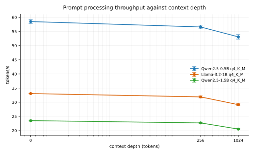
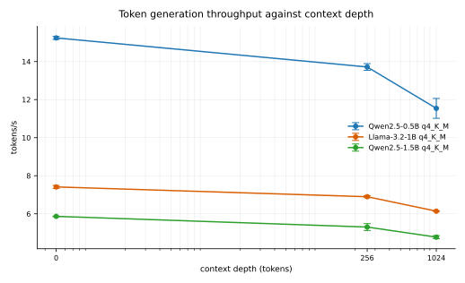

# llama.cpp on Mac Pro 3,1 (OS X 10.11)

This branch makes llama.cpp build and run on a Mac Pro 3,1 with OS X 10.11.6 El Capitan, using the
CPU backend. GPU acceleration is not possible on this machine; the evidence is below, and the
measured throughput of the CPU backend is at the end.

The numbers here are from the kernel build (Section "Changes in this branch") at **7 threads**. The
one-paragraph reason for 7 and not 8 is under "Measured throughput"; the full argument, with the
measurements, is in [`build-macpro31-perf.md`](build-macpro31-perf.md).

## Hardware and software

| Item | Value |
|---|---|
| CPU | 2x Xeon X5482 (Harpertown), 8 cores, SSE4.1, no AVX |
| RAM | 32 GiB |
| GPU | NVIDIA Quadro 4000 (Fermi GF100), 2 GiB |
| OS | OS X 10.11.6, Darwin 15.6 |
| Compiler | GCC 10.2.0 (MacPorts), because Apple clang cannot build this tree |
| CMake / Ninja | 3.19.6 / 1.10.2 |

## Why GCC 10 and not Apple clang

Apple clang 8.0 (Xcode 8.2) rejects `-std=c++17`, and libc++ marks `std::filesystem` as
`unavailable: introduced in macOS 10.15`, so this tree cannot be built with it on El Capitan:

```
.../include/c++/v1/filesystem:738:24: error: 'path' is unavailable: introduced in macOS 10.15
```

GCC 10 ships its own libstdc++, which implements C++17 and `std::filesystem` with no deployment
target restriction. Two consequences follow from using it:

- The Accelerate framework headers (`Accelerate.h` -> `vecLib.h` -> `vBasicOps.h`) use vector
  types that GCC rejects, so `GGML_ACCELERATE` must stay off. `ggml-blas` includes
  `Accelerate.h` too, so the BLAS backend is off as well. This costs almost nothing: `ggml-blas`
  only accelerates F32 tensors, so it never applies to quantized models.
- The Metal backend cannot compile at all: the 10.11 Foundation headers use Objective-C
  generics and nullability, which GCC 10 does not support.

## Changes in this branch

- `ggml/src/ggml.c`: `ggml_time_ms()` and `ggml_time_us()` call `clock_gettime(CLOCK_MONOTONIC)`,
  which only exists from macOS 10.12. On Apple platforms whose headers do not define
  `CLOCK_MONOTONIC` they now use `mach_absolute_time()` instead. Without this the file does not
  compile on El Capitan: `error: 'CLOCK_MONOTONIC' undeclared`.
- `tests/test-tiled-mulmat.cpp`: the same missing `clock_gettime`. It now uses `ggml_time_us()`,
  which removes the timer `#ifdef` and the `windows.h` and `time.h` includes.
- `ggml/CMakeLists.txt` and `docs/build.md`: Metal is no longer on by default for Darwin < 22,
  because the backend relies on Metal 3 era APIs that older SDKs do not declare and older
  runtimes do not implement. Pass `-DGGML_METAL=ON` to build it anyway.
- `ggml/src/ggml-cpu/arch/x86/quants.c`: SSSE3 dot-product kernels for `q4_K`, `q6_K`, `q5_0` and
  `q8_0`, in the same per-ISA style the file already uses for the other formats. Before this,
  those four formats fell through to scalar reference code on any CPU without AVX2, which is
  this one. It is the largest single change in throughput: prefill 3.5x to 3.7x on the K-quant
  models, and generation 1.3x. [`build-macpro31-perf.md`](build-macpro31-perf.md) has the A/B
  measurements and the correctness checks (perplexity, fixed-seed greedy output, and each kernel
  against its generic reference).
- `scripts/build-macpro31.sh`: builds with `-DGGML_OPENMP=OFF` and `-DLLAMA_USE_PREBUILT_UI=OFF`.
  OpenMP is the other large change: MacPorts GCC ships libgomp, so the default configuration
  found it and put a barrier at every compute node, which costs 2x to 3.2x on generation.
  The prebuilt-UI download fails against the current Hugging Face bundle layout; skipping it
  still builds `llama-server`, it just embeds an empty UI.

## GPU acceleration: not available on this machine

No GPU backend in this tree can run on a Mac Pro 3,1. This is a property of the hardware and the
OS, not of the build:

| Backend | Why it cannot run |
|---|---|
| Metal | `MTLCreateSystemDefaultDevice()` returns nil. The Quadro 4000 is Fermi (GF100), and Metal needs Kepler or newer on NVIDIA. The backend also needs Metal 3 era APIs that 10.11 does not have. |
| Vulkan | macOS has no native Vulkan and MoltenVK is built on Metal. There is no Vulkan loader on the machine: `Could NOT find Vulkan (missing: Vulkan_LIBRARY Vulkan_INCLUDE_DIR)`. |
| CUDA | The installed toolkits are 4.1 and 7.0. `ggml-cuda` needs CUDA 11 or newer and compute capability 5.0 or newer; Fermi is 2.0, and CUDA 8.0 was the last release supporting macOS. |
| OpenCL | The backend targets OpenCL 3.0 with Adreno kernels. The Quadro 4000 offers OpenCL 1.1. |
| SYCL, HIP, MUSA, CANN, Hexagon | Vendor platforms that do not exist for macOS. |

So there is one build and not two. The GPU still drives the display; it just cannot compute here.

## Building

```
sudo port install gcc10 cmake ninja
scripts/build-macpro31.sh          # build build-macpro31-cpu
scripts/build-macpro31.sh check    # build, then run the tests that check CPU kernels
```

Binaries land in `build-macpro31-cpu/bin`.

## Verification on this machine

- `test-quantize-fns`, `test-gguf` (101/101), `test-sampling` and `test-tiled-mulmat` pass.
  `test-tiled-mulmat` reports `max_err: 0.000000` for every quantized type, including the new
  `q4_K` path, so the SSSE3 kernels agree with the reference implementation.
- `test-backend-ops` skips the CPU backend by design and therefore proves nothing here.
- Greedy generation with Qwen2.5-0.5B-Instruct Q4_K_M answers `The capital of France is Paris.`
- The HTTP server answers `/health` with `{"status":"ok"}` and returns a correct completion.

## Measured throughput

This section covers models up to 1.5B and contexts up to 1024 tokens. The larger sweep, up to 32B
and contexts up to 4096, is in [`build-macpro31-scale.md`](build-macpro31-scale.md).

Every number comes from `scripts/bench-macpro31.sh`, which is committed so the sweep can be
repeated. The raw llama-bench records are in `docs/macpro31/bench-context.jsonl`,
`bench-quant.jsonl` and `bench-coverage.jsonl`; `scripts/plot-macpro31.py` turns them into the
charts and `docs/macpro31/results.csv`.

### Method

- `llama-bench`, CPU backend, **7 threads**, batch and ubatch at their defaults, Flash Attention
  `auto`.
- **Why 7 and not 8.** Eight worker threads on eight cores leaves no headroom for the rest of the
  system, and generation collapses: on this machine 0.5B q4_K_M measures 15.0 tokens/s at 7
  threads and 3.3 at 8, with the same build and the same model, reproducibly. 7 threads leaves one
  core free and matches the A/B figures in `build-macpro31-perf.md`. Every table here is 7 threads.
- A prompt processing test is 128 tokens, a token generation test is 32 tokens.
- Context depth is swept with `-d`: llama-bench fills the context with that many tokens first, then
  runs the test. It builds the context once for the prompt test and again for the generation test,
  so wall time grows with roughly twice the depth prefill cost.
- Each repetition is a separate `llama-bench` process. The full run list is shuffled with a fixed
  seed before it starts, so drift on the machine (thermal, background work) spreads across every
  model and depth instead of landing on whichever condition ran first. The realized order is
  committed as `macpro31/bench-all-plan.tsv`.
- Four independent processes per condition. Error bars and the `sd` column are plus or minus one
  sample standard deviation of those four values, so they show run-to-run spread. They are not a
  confidence interval for the mean, and they do not cover conditions the sweep did not vary.
- Before every run the script waits until background CPU (Spotlight, Time Machine, virus scan) is
  under 20 percent and the load average is under 12. Spotlight indexes external volumes on this
  machine and Time Machine thins them, so the gate is what keeps that noise out of the numbers.

### Prompt processing against context depth



| model | depth | n | tokens/s | sd |
|---|---|---|---|---|
| Qwen2.5-0.5B q4_K_M | 0 | 4 | 57.46 | 0.30 |
| Qwen2.5-0.5B q4_K_M | 256 | 4 | 55.73 | 0.39 |
| Qwen2.5-0.5B q4_K_M | 1024 | 4 | 51.84 | 0.67 |
| Llama-3.2-1B q4_K_M | 0 | 4 | 32.37 | 0.09 |
| Llama-3.2-1B q4_K_M | 256 | 4 | 31.41 | 0.03 |
| Llama-3.2-1B q4_K_M | 1024 | 4 | 28.81 | 0.04 |
| Qwen2.5-1.5B q4_K_M | 0 | 4 | 23.01 | 0.04 |
| Qwen2.5-1.5B q4_K_M | 256 | 4 | 21.96 | 0.35 |
| Qwen2.5-1.5B q4_K_M | 1024 | 4 | 20.09 | 0.10 |

### Token generation against context depth



| model | depth | n | tokens/s | sd |
|---|---|---|---|---|
| Qwen2.5-0.5B q4_K_M | 0 | 4 | 15.24 | 0.08 |
| Qwen2.5-0.5B q4_K_M | 256 | 4 | 13.71 | 0.18 |
| Qwen2.5-0.5B q4_K_M | 1024 | 4 | 11.54 | 0.52 |
| Llama-3.2-1B q4_K_M | 0 | 4 | 7.41 | 0.08 |
| Llama-3.2-1B q4_K_M | 256 | 4 | 6.90 | 0.05 |
| Llama-3.2-1B q4_K_M | 1024 | 4 | 6.14 | 0.01 |
| Qwen2.5-1.5B q4_K_M | 0 | 4 | 5.86 | 0.02 |
| Qwen2.5-1.5B q4_K_M | 256 | 4 | 5.30 | 0.18 |
| Qwen2.5-1.5B q4_K_M | 1024 | 4 | 4.77 | 0.08 |

### Quantization at depth 0

All four are the same Qwen2.5-0.5B model, so this isolates the quantization format.


| quantization | test | n | tokens/s | sd |
|---|---|---|---|---|
| q4_0 | prompt | 4 | 69.74 | 0.71 |
| q4_0 | generation | 4 | 16.22 | 0.66 |
| q4_K_M | prompt | 4 | 57.58 | 0.19 |
| q4_K_M | generation | 4 | 15.18 | 0.22 |
| q8_0 | prompt | 4 | 55.81 | 0.41 |
| q8_0 | generation | 4 | 11.48 | 0.04 |
| f16 | prompt | 4 | 13.36 | 0.04 |
| f16 | generation | 4 | 5.15 | 0.09 |

### Throughput against model size


## What the numbers say

- **Prompt processing is now compute bound at a much higher rate.** Q4_K_M gives 56.9, 32.4 and
  23.0 tokens/s for 0.63B, 1.24B and 1.78B, which is 72, 80 and 82 GFLOP/s effective (two
  operations per parameter). Before the SSSE3 kernels the same sweep worked out to about 21-26
  GFLOP/s: the K-quant formats were running scalar reference code, so the vector unit sat idle.
- **Generation is bandwidth bound and now at the memory ceiling.** 0.5B, 1B and 1.5B generate at
  15.2, 7.4 and 5.9 tokens/s. With 0.49, 0.80 and 1.11 GB of weights those are 7.3, 6.0 and
  6.5 GB/s read, against 7.14 GB/s measured for this machine with an 8-thread streaming probe: 84
  to 102 percent of it. There is no headroom left; generation cannot be made faster without a
  faster memory system.
- **Context costs both, and generation more.** From depth 0 to 1024, generation retains 76, 83 and
  82 percent on the three models, while prompt processing retains 90, 89 and 87 percent. The
  attention pass reads the KV cache on every generated token and that read grows with the
  context, so the cost lands on generation.
- **The old 4.4x advantage of Q4_0 over Q4_K_M is gone.** It was an artifact of `q4_K_M` having no
  vector kernel on a CPU without AVX2. With kernels for both, q4_0 leads q4_K_M by 21 percent on
  prefill (69.7 against 57.6) and 7 percent on generation (16.2 against 15.2). Q4_K_M remains the
  better quality per byte, and on this machine it is no longer a throughput penalty.
- **f16 is now the slow choice**, at 13.4 tokens/s prefill and 5.2 generation: four times the
  bytes per weight of a 4-bit format, and no integer dot-product path to exploit.
- **Practical advice for this machine:** the 0.5B is the model this CPU can hold a conversation
  with (12-15 tokens/s generation, 52-57 prefill), the 1.5B is usable in batch or with patience
  (4.8-5.9 generation, 20-23 prefill), and anything larger belongs to the batch section of
  [`build-macpro31-scale.md`](build-macpro31-scale.md).

## Reproducing the numbers

```
scripts/build-macpro31.sh
MODELS_DIR=~/models THREADS=7 scripts/bench-macpro31.sh all      # a few hours on this machine
python3 scripts/plot-macpro31.py \
    docs/macpro31/bench-context.jsonl docs/macpro31/bench-quant.jsonl docs/macpro31
python3 scripts/plot-macpro31-large.py \
    docs/macpro31/bench-scale.jsonl docs/macpro31/bench-depth.jsonl docs/macpro31
```

`bench-macpro31.sh` needs `MODELS_DIR` to contain the GGUF files it names, plus a `coverage` phase
that walks every `*.gguf` in it. The sweep is slow because llama-bench rebuilds the depth context
for each of its two tests, so depth dominates the cost. It is resumable: runs already listed in
the done file are skipped, so an interrupted sweep continues where it stopped.
