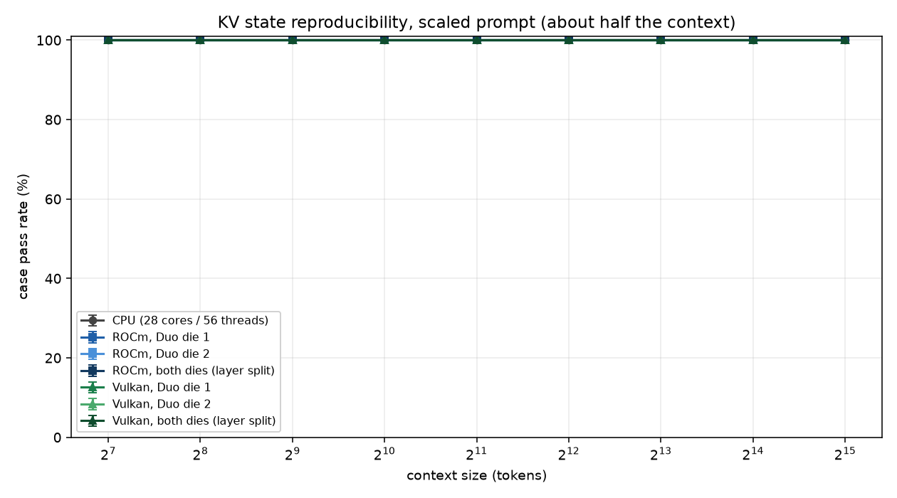
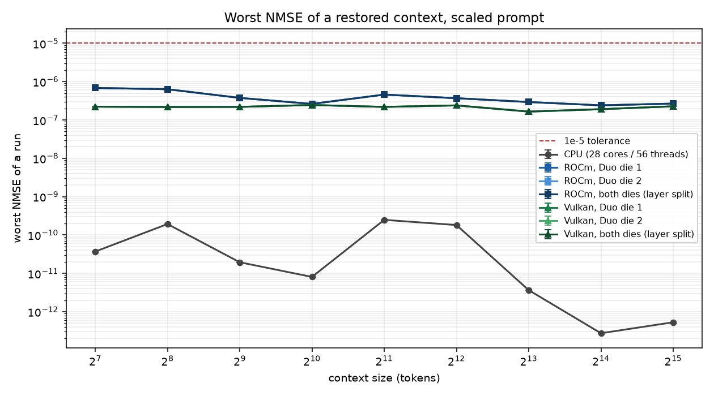
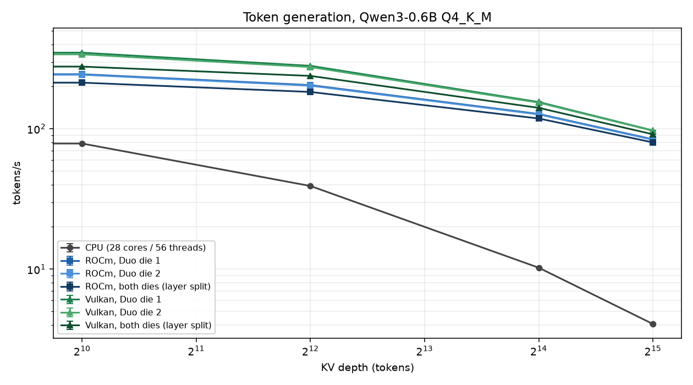
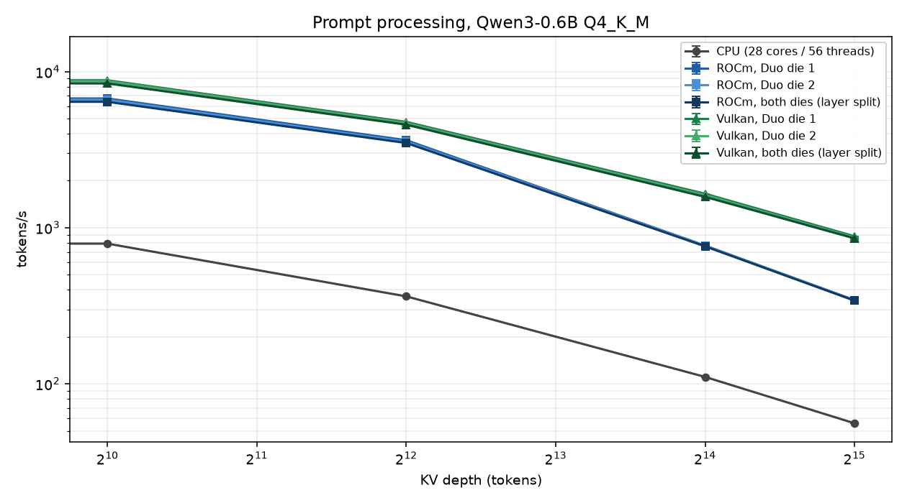

# The Mac Pro 7,1 on Fedora: CPU, both W6800X dies, and both backends

What this machine is, what it can do in llama.cpp, and how it was measured. Three
axes are swept together: the device (the CPU, each die of the Radeon Pro W6800X
Duo, and both dies together), the backend (ROCm/HIP and Vulkan), and the context
size.

The correctness question is whether a saved KV state comes back bit for bit on
every device at every context size, which is what `test-llama-context` checks.
The performance question is what each topology delivers for prompt processing and
token generation as the context fills up.

| section | what it answers |
|---|---|
| [The machine](#the-machine) | which GPU is which, in both backends |
| [Method](#method) | what was run, on what, and how the error bars are made |
| [Correctness](#correctness) | does a restored context reproduce, everywhere |
| [Throughput](#throughput) | what each topology delivers against depth |
| [Split modes on the duo](#split-modes-on-the-duo) | what a second GPU can and cannot be asked to do |
| [Mixed backends](#mixed-backends) | one run that uses ROCm and Vulkan at once |
| [Reproducing](#reproducing) | the exact commands |

## What this found

1. **Everything passes.** 25 893 case verdicts per prompt mode, on the CPU, on
   each die, and on both dies, on ROCm and on Vulkan, at every context size from
   128 to 32768. No failure, and not one cell where three repetitions disagreed.
2. **The layer split is numerically free.** Within a backend, one die and two
   dies produce the same worst NMSE to every digit in the state test, and the same
   KL divergence to every printed digit against CPU logits. The second die costs
   throughput, not accuracy.
3. **Vulkan is the faster backend on gfx1030 here.** 1.40x prompt and 1.57x
   generation over ROCm on one die at depth 0 for the 0.6B model, and 2.9x prompt
   at depth 32768 for the 8B.
4. **The duo buys capacity, not speed.** With a model that fits on one die, the
   layer split reduces generation by 4 % to 21 % depending on the model. None of
   the models here needed 64 GiB.
5. **Flash attention is the wrong choice for long prompt processing on ROCm.**
   At depth 16384 the non-flash path is 2x faster for pp512, while generation
   needs flash attention by 2.6x. The default is right for interactive use; a
   prefill-heavy workload should know about the crossover.
6. **Mixing ROCm and Vulkan in one run works**, is numerically correct, and runs
   at the speed of its slowest stage.

Raw data is in `data/`, charts in `charts/`, the scripts in `scripts/`. The
sibling study in `../vulkan-context-size-study/` is the original record of the
cross-device copy defect and its fix; this document covers the whole machine.

## The machine

| part | detail |
|---|---|
| CPU | Intel Xeon W-3275, 28 cores / 56 threads, AVX-512 including VNNI |
| GPU A+B | Radeon Pro W6800X **Duo**: two Navi 21 dies in one MPX module, gfx1030, wave32, 60 CU, 32 GiB each |
| GPU C | Radeon Pro Vega II: gfx906, wave64, 32 GiB |
| OS | Fedora 44, kernel 6.x, Mesa RADV 26.2.6, ROCm 7.1.1 (hip 7.1.52802) |
| build target | `gfx1030` only, so the Vega II carries no device code |

The two backends number the cards differently. This is the single most important
fact when reading anything below, because a device index on its own is
meaningless:

| card | PCI | arch | ROCm index | Vulkan index |
|---|---|---|---|---|
| W6800X die 1 | 0b:00.0 | gfx1030 | ROCm0 | Vulkan1 |
| W6800X die 2 | 0e:00.0 | gfx1030 | ROCm1 | Vulkan2 |
| Radeon Pro Vega II | 18:00.0 | gfx906 | ROCm2 | Vulkan0 |

So "the duo" is `HIP_VISIBLE_DEVICES=0,1` on ROCm and
`GGML_VK_VISIBLE_DEVICES=1,2` on Vulkan. Both filters are applied in this study,
which is why the Vega II never appears in a result. It is also not a build target:
the ROCm binary holds no gfx906 code and segfaults at model load if the card is
left visible.

Verified with `llama-bench --list-devices` (see `data/devices.txt`):

```
ROCm0: AMD Radeon Graphics (32752 MiB)   gfx1030  wave32
ROCm1: AMD Radeon Graphics (32752 MiB)   gfx1030  wave32
ROCm2: AMD Radeon Graphics (32752 MiB)   gfx906   wave64    <- not a build target
Vulkan0: AMD Radeon Graphics (RADV VEGA20)  32752 MiB      <- the Vega II
Vulkan1: AMD Radeon Graphics (RADV NAVI21)  32768 MiB
Vulkan2: AMD Radeon Graphics (RADV NAVI21)  32768 MiB
```

## Method

Every row of every table comes from one of two shipped test binaries, run through
`scripts/matrix.py` and `scripts/bench.py`. Both scripts define the topology once,
in `scripts/common.py`, so a label in a chart means the same thing in every
figure.

### Correctness: `test-llama-context`

The test saves a KV state mid-generation, restores it into a fresh context, and
compares the logits of the continued run against the run that saved it. A case
passes when the NMSE against its own baseline is inside tolerance. It runs 18
cases per model; 13 of them need only attention, 5 need a recurrent model.

| axis | values |
|---|---|
| device | CPU, ROCm die 1, ROCm die 2, ROCm both, Vulkan die 1, Vulkan die 2, Vulkan both |
| context size | 128, 256, 512, 1024, 2048, 4096, 8192, 16384, 32768 |
| prompt | scaled (about half the context, so a bigger context also means more occupied rows) and built in (100 tokens, so the work per graph stays constant) |
| repetitions | 3 per cell |
| models | 10, chosen so every case can run somewhere: dense, sliding window, MLA, MoE, and recurrent |

The prompt axis is there for a reason. With the built in prompt a bigger context
only means a bigger allocation; with the scaled prompt it also means a larger KV
state and more rows in the attention, so capacity and correctness move together.

`-ngl 99` (or `-dev none` on the CPU) pins the placement instead of leaving it to
auto-fit, so "Vulkan die 1" really is one die running every layer.

### Throughput: `llama-bench`

`llama-bench` fills the KV cache to `-d` tokens before it measures, so the depth
is the context size the run actually works at: at depth 32768 a generation step
attends over 32768 rows instead of 128. Each cell measures prompt processing
(pp512) and generation (tg128) at that depth.

Statistics: a rate is reported with a Wilson score interval over case verdicts,
and a throughput as the mean of the repetitions with a Student t interval for
95 %. A zero width bar is a real result (the repetitions agreed), not a missing
measurement.

The machine is shared and was busy during part of the work, so the load average at
the start of each benchmark block is recorded with the numbers.

## Correctness

### KV state reproducibility

189 runs per prompt mode (7 topologies x 9 context sizes x 3 repetitions), each
run scoring 137 case verdicts, so 25 893 verdicts per prompt mode. **All pass, in
both prompt modes, on every topology, at every context size from 128 to 32768.**



| topology | runs | cases passed | rate | worst NMSE |
|---|---|---|---|---|
| CPU (28 cores / 56 threads) | 27 | 3699/3699 | 100.00 +/- 0.05 % | 2.49e-10 |
| ROCm, Duo die 1 | 27 | 3699/3699 | 100.00 +/- 0.05 % | 6.84e-07 |
| ROCm, Duo die 2 | 27 | 3699/3699 | 100.00 +/- 0.05 % | 6.84e-07 |
| ROCm, both dies (layer split) | 27 | 3699/3699 | 100.00 +/- 0.05 % | 6.84e-07 |
| Vulkan, Duo die 1 | 27 | 3699/3699 | 100.00 +/- 0.05 % | 2.45e-07 |
| Vulkan, Duo die 2 | 27 | 3699/3699 | 100.00 +/- 0.05 % | 2.45e-07 |
| Vulkan, both dies (layer split) | 27 | 3699/3699 | 100.00 +/- 0.05 % | 2.45e-07 |

The same table for the built in prompt is in `data/matrix-builtin.csv` and comes
out the same way; the scaled prompt is the harder case because the KV state is
larger and the attention has more rows, so it is the one charted.

| topology | 128 | 256 | 512 | 1k | 2k | 4k | 8k | 16k | 32k |
|---|---|---|---|---|---|---|---|---|---|
| CPU | pass | pass | pass | pass | pass | pass | pass | pass | pass |
| ROCm die 1 | pass | pass | pass | pass | pass | pass | pass | pass | pass |
| ROCm die 2 | pass | pass | pass | pass | pass | pass | pass | pass | pass |
| ROCm both | pass | pass | pass | pass | pass | pass | pass | pass | pass |
| Vulkan die 1 | pass | pass | pass | pass | pass | pass | pass | pass | pass |
| Vulkan die 2 | pass | pass | pass | pass | pass | pass | pass | pass | pass |
| Vulkan both | pass | pass | pass | pass | pass | pass | pass | pass | pass |



Three things are worth reading off the NMSE table.

The margin is large everywhere. The tolerance the sibling study uses is 1e-5; the
worst result on any GPU is 6.8e-7, five orders of magnitude inside it. The CPU,
which has no quantization kernel to differ from, sits at 2.5e-10.

**The two dies change nothing.** Within a backend the worst NMSE is identical to
every digit whether the run used die 1, die 2, or both. If the layer split
introduced any error of its own, "both dies" would be the worst of the three; it
is not, it is exactly as good as one die.

**The runs are reproducible.** Across the 63 topology-by-context cells there is
not one where the three repetitions disagreed on the worst NMSE. Before the fix in
`../vulkan-context-size-study/` the same measurement on both Vulkan dies produced
a different, much larger number on every repetition, because the corruption
depended on how the workers interleaved. A cell with a single distinct value is
the signature of code that no longer depends on timing.

### Do the devices compute what the CPU computes?

`test-llama-context` is a self-consistency test: it compares a device against
itself. The complementary question is whether the two dies together, or either
die alone, produce the distribution the CPU produces from the same weights. That
is what `scripts/agreement.py` measures, with `llama-perplexity`'s KL divergence
mode: the CPU saves its logits for a fixed corpus of 2 chunks of 512 tokens from
`Qwen3-0.6B-Q4_K_M`, and every GPU topology scores the same corpus against that
file.

| topology | mean KLD | RMS delta p | same top p |
|---|---|---|---|
| ROCm, Duo die 1 | 0.00861 +/- 0.00147 | 2.378 +/- 0.399 % | 97.25 +/- 0.72 % |
| ROCm, Duo die 2 | 0.00861 +/- 0.00147 | 2.378 +/- 0.399 % | 97.25 +/- 0.72 % |
| ROCm, both dies | 0.00861 +/- 0.00147 | 2.378 +/- 0.399 % | 97.25 +/- 0.72 % |
| Vulkan, Duo die 1 | 0.00764 +/- 0.00102 | 2.574 +/- 0.526 % | 96.67 +/- 0.80 % |
| Vulkan, Duo die 2 | 0.00764 +/- 0.00102 | 2.574 +/- 0.526 % | 96.67 +/- 0.80 % |
| Vulkan, both dies | 0.00764 +/- 0.00102 | 2.574 +/- 0.526 % | 96.67 +/- 0.80 % |

Two things follow, and the second is the important one.

Both backends differ from the CPU by a similar small amount, about 0.8 % mean KLD
and 2.5 % RMS delta p. That is the width of a Q4_K_M kernel difference: ROCm and
Vulkan accumulate a quantized dot product in a different order than the CPU
reference does. It is not a defect, and it is the size every quantized cross
backend comparison lands at.

Within a backend the three topologies are **identical to every printed digit**.
Two dies with a layer split produce exactly the statistics one die produces. So
the layer split introduces no error of its own: whatever a single die gets, the
pair gets the same. That is the property the cross-device copy defect in
`../vulkan-context-size-study/` destroyed, and it is worth stating as a number
because a bad split shows up here immediately and not always in a pass rate.

The corpus is deliberately small (2 chunks). The metric is an average over about
5000 positions, which is enough to separate 0.008 from 0.8, and the run stays
seconds long so it can be repeated after every change.

## Throughput

Depth is the axis that matters for a context study, because every extra row of KV
is another row the attention has to read. `llama-bench` fills the cache to depth
before it times anything, so a `tg` number at depth 32768 is a decode step that
attends over 32768 positions rather than a fresh one.

Two things are measured at each depth: prompt processing of 512 tokens (pp512) and
generation of 128 tokens (tg128). The first is bandwidth bound, the second is
latency bound, and they degrade with depth at very different rates.





### Qwen3-0.6B Q4_K_M, tokens/s at depth

Small enough that the model, its KV cache and every buffer fit on one die with
room to spare, so this is the pure compute comparison.

| topology | pp 0 | pp 4096 | pp 32768 | tg 0 | tg 4096 | tg 32768 |
|---|---|---|---|---|---|---|
| CPU (28 cores / 56 threads) | 1319.5 | 363.5 | 56.0 | 107.5 | 39.1 | 4.1 |
| ROCm, die 1 | 9123.4 | 3633.1 | 344.0 | 264.6 | 204.9 | 84.2 |
| ROCm, die 2 | 8948.0 | 3554.7 | 343.5 | 260.9 | 202.9 | 83.5 |
| ROCm, both dies | 8508.9 | 3486.3 | 341.2 | 224.2 | 183.1 | 80.0 |
| Vulkan, die 1 | 12765.3 | 4759.3 | 881.7 | 415.3 | 281.3 | 97.3 |
| Vulkan, die 2 | 12632.4 | 4676.3 | 865.2 | 406.3 | 275.5 | 96.8 |
| Vulkan, both dies | 11989.0 | 4566.1 | 854.7 | 327.8 | 238.3 | 91.4 |

### Qwen3-8B Q8_0, tokens/s at depth

8.7 GiB of weights, still inside one 32 GiB die, but now large enough that the
weight traffic dominates the arithmetic.

| topology | pp 0 | pp 16384 | pp 32768 | tg 0 | tg 16384 | tg 32768 |
|---|---|---|---|---|---|---|
| ROCm, die 1 | 1476.7 | 218.5 | 102.5 | 48.1 | 38.3 | 32.1 |
| ROCm, die 2 | 1466.3 | 219.4 | 102.3 | 48.0 | 38.2 | 32.1 |
| ROCm, both dies | 1460.8 | 219.2 | 101.9 | 46.7 | 37.4 | 31.5 |
| Vulkan, die 1 | 1228.8 | 481.7 | 298.4 | 54.1 | 41.0 | 33.3 |
| Vulkan, die 2 | 1218.1 | 476.3 | 294.7 | 53.8 | 40.7 | 32.9 |
| Vulkan, both dies | 1247.1 | 476.3 | 294.1 | 51.8 | 39.7 | 32.5 |

### Qwen3-30B-A3B Q4_K_M, tokens/s at depth

18.5 GiB of weights and a sparse 3B active path: the largest model here, and the
one closest to the 32 GiB limit of a single die.

| topology | pp 0 | pp 32768 | tg 0 | tg 32768 |
|---|---|---|---|---|
| ROCm, die 1 | 1639.1 | 154.8 | 94.8 | 55.6 |
| ROCm, die 2 | 1622.5 | 153.3 | 94.0 | 54.9 |
| ROCm, both dies | 1579.1 | 153.1 | 88.6 | 53.0 |
| Vulkan, die 1 | 1587.3 | 253.9 | 124.2 | 64.7 |
| Vulkan, die 2 | 1576.8 | 251.6 | 122.7 | 64.4 |
| Vulkan, both dies | 1672.2 | 252.2 | 117.4 | 62.1 |

### What the numbers say

**Vulkan is the faster backend on this silicon.** On one die at depth 0 the
Vulkan build processes a prompt 1.40x faster and generates tokens 1.57x faster
than the ROCm build for the 0.6B model, and 1.12x faster for generation on the
8B. ROCm is ahead only on 8B prompt processing at depth 0 (1477 against 1229),
and it loses that lead badly as the context fills: at depth 32768 Vulkan
processes the same prompt 2.9x faster (298 against 102). For a ROCm 7.1 build of
this tree on gfx1030, Vulkan is the better default.

**The two dies are interchangeable.** Die 1 and die 2 agree to within 3 % on
every cell in every model. That is the expected result for two chips of one
module and it also means the single die series are not lucky or unlucky.

**The second die costs throughput when the model already fits.** With a layer
split the pipeline crosses the device boundary once per layer, and that copy is
pure overhead when the model would have fitted anyway:

| model | pp both/one | tg both/one |
|---|---|---|
| 0.6B, depth 0 | 0.94x | 0.79x |
| 8B, depth 0 | 1.01x | 0.96x |
| 30B, depth 0 | 1.05x | 0.95x |

For the 0.6B that is a 21 % generation loss for no gain. The 30B, which is the
only model here that presses on 32 GiB, is the exception on prompt processing
(1.05x) but still loses 5 % on generation. Since the KV cache in this tree grows
on demand, none of these models actually needed the second die; the conclusion is
that the duo buys capacity, not speed, and that a workload which fits on one die
should stay on one die.

**Context is what separates CPU from GPU, not the model size.** Token generation
on the CPU falls from 107.5 to 4.1 tokens/s between depth 0 and 32768, a factor
of 26, while one Vulkan die falls only from 415.3 to 97.3, a factor of 4.3. At
depth 0 the GPU is 3.9x the CPU; at depth 32768 it is 24x. Prompt processing
degrades on both, but the CPU starts 9.7x behind and ends 15.7x behind. A long
context is exactly the case where the CPU stops being usable and the GPU scales
gently.

### Flash attention is not always the faster choice on ROCm

`-fa auto` selects flash attention, which is the right default for generation,
and on this GPU it is the wrong choice for prompt processing once the context is
long. Measured on one die, prompt processing of 512 tokens:

| depth | ROCm -fa 1 | ROCm -fa 0 | Vulkan -fa 1 | Vulkan -fa 0 |
|---|---|---|---|---|
| 0 | 1470.9 | 1351.6 | 1231.6 | 1218.3 |
| 4096 | 772.2 | 357.1 | 890.7 | 873.7 |
| 16384 | 221.5 | 443.9 | 481.5 | 409.4 |

On Qwen3-8B-Q8_0 the crossover is between depth 4096 and 16384: at 4096 flash
attention is 2.2x faster than the non-flash path, at 16384 it is 2.0x slower. The
same crossover appears on Qwen3-0.6B at depth 16384 (768.3 with `-fa 1` against
1273.8 with `-fa 0`), so it is a property of the kernel and the head size rather
than of one model.

Turning flash attention off to recover prompt processing is the wrong trade on
ROCm, because generation collapses at the same time: 37.9 against 14.7 tokens/s
on the 8B at depth 16384. The default is therefore correct for interactive use
and the cost lands on long prompt processing, which is the case a prefill
benchmark measures. Vulkan shows no such crossover and gains from flash attention
at every depth tested.

The likely cause is the tile choice. `ggml-cuda: fix flash attention tiles that
cannot launch on RDNA2` (`ebb73a303`, one commit back from this study's baseline)
makes a tile that cannot reach one block per CU fall through to a smaller one.
The fallback restored correctness at the cost of the wide tile, and a narrow tile
is what makes a long K loop slow. That is a hypothesis, not a measurement: the
data here establishes the crossover, not its cause.

## Split modes on the duo

A second GPU is only useful if the layers can be spread over it. `llama-bench
-sm` has three modes, and on this pair of dies only two of them run:

| split mode | ROCm (0,1) | Vulkan (1,2) |
|---|---|---|
| `layer` (default) | works | works |
| `tensor` | works | works |
| `row` | **refused** | **refused** |

Both backends refuse the row split at model load, before any kernel runs:

```
llama_model_load: error loading model: device ROCm0 does not support split buffers
llama_model_load: error loading model: device Vulkan0 does not support split buffers
```

This is a ggml capability, not a per-backend defect: a row split needs a tensor
whose rows live in different device buffers, and `ggml_backend_buffer` has no way
to express that. It fails closed, which is the right behaviour, and it is the same
on both backends rather than a Vulkan quirk.

Every result below therefore uses the default layer split.

## Mixed backends

Every other section runs one backend at a time, because that is what the shipped
test binaries do: `test-backend-ops -b ROCm0` or `-b Vulkan0`, never both. A build
with `-DGGML_HIP=ON -DGGML_VULKAN=ON` carries six device entries on this machine
and puts half the layers on a ROCm device and half on a Vulkan one, which is a
configuration nothing in the tree exercises.

It works. `scripts/mixed.py` runs it:

```
$ build-mixed/bin/llama-bench --list-devices
  ROCm0   ROCm1   ROCm2   Vulkan0   Vulkan1   Vulkan2
```

| config | prompt t/s | gen t/s | mean KLD vs CPU | same top p |
|---|---|---|---|---|
| ROCm only (`ROCm0`) | 3244.7 | 260.3 | 0.011530 | 95.69 % |
| Vulkan only (`Vulkan2`) | 6160.8 | 402.7 | 0.009582 | 95.44 % |
| mixed (`ROCm0/Vulkan2`) | 3733.1 | 248.4 | 0.011148 | 95.93 % |
| mixed (`Vulkan1/ROCm1`) | 4023.1 | 276.5 | 0.009611 | 95.59 % |

Prompt throughput is 64 tokens and generation is 16 tokens, three repetitions,
Qwen3-0.6B Q4_K_M. Correctness is the same KL divergence measurement as above,
over 8 chunks of 512 tokens, against logits the CPU saved.

Two conclusions. The mixed runs are **numerically correct**: their divergence from
the CPU sits between the two pure backends (0.0096 and 0.0111 against 0.0096 for
pure Vulkan and 0.0115 for pure ROCm), so the cross-backend boundary in every
layer adds no error that this measurement can see. And they are **not faster**:
a layer split is a pipeline, so the slower backend sets the pace, and mixed
generation lands at 248 to 277 tokens/s against 403 for Vulkan alone.

The selectors differ between the two tools, which is worth knowing before trying
this:

```
llama-bench      -dev 'ROCm0/Vulkan2'    # a comma here starts a second test
llama-perplexity -dev  ROCm0,Vulkan2     # the usual common_params list
```

With a comma, llama-bench silently runs the benchmark twice, once per device, and
prints two sets of rows. It looks like a mixed run in the output and is not one.

## Reproducing

From `notes/macpro71fedora-backends/`:

```
../../scripts/build-macpro71fedora.sh both

python3 scripts/matrix.py --csv data/matrix-scaled.csv \
    --ctxs 128,256,512,1024,2048,4096,8192,16384,32768 --reps 3 --prompt-mode scaled
python3 scripts/matrix.py --csv data/matrix-builtin.csv \
    --ctxs 128,256,512,1024,2048,4096,8192,16384,32768 --reps 3 --prompt-mode builtin

python3 scripts/agreement.py --model Qwen3-0.6B-Q4_K_M.gguf --ctx 512 --chunks 2

python3 scripts/bench.py --label run1 --csv data/bench-qwen06.csv \
    --model Qwen3-0.6B-Q4_K_M.gguf --depths 0,1024,4096,16384,32768 --reps 3
python3 scripts/bench.py --label run1 --csv data/bench-qwen8.csv \
    --model Qwen3-8B-Q8_0.gguf --depths 0,4096,16384,32768 --reps 2 \
    --topologies rocm-die1,rocm-die2,rocm-both,vk-die1,vk-die2,vk-both

python3 scripts/report.py     # the markdown tables above
python3 scripts/charts.py     # the figures above
scripts/device-tests.sh       # the shipped test binaries, per topology
```

`agreement.py` writes a 155 MB logits file into `../logs/agreement/`. It is a
derived artifact and is not committed.

## Limitations

- Context is a runtime limit on this tree, not an allocation limit. The KV cache
  grows on demand, so `capacity.py` reports that a single 32 GiB die *accepts* a
  1048576-token context for an 18.5 GiB model and allocates almost none of it.
  What actually fails is a fill, which is why the depth sweeps stop at 32768
  tokens: past that the fill itself takes longer than the measurement is worth,
  and the arithmetic (18.5 GiB of weights plus 96 KiB per token of KV against
  32 GiB) predicts the wall without needing to find it.
- The correctness sweep uses the generated test models that ship with the tree,
  a few megabytes each, not production weights. They are small enough that the
  KV cache fits in VRAM at 32768 tokens, so no pressure-induced fallback is
  exercised; the 8B and 30B models in the throughput section are what supply the
  memory pressure.
- Reproducibility is asserted against a baseline computed in the same process and
  the same configuration. The KL divergence section is the part that compares
  against a different backend.
- The two dies are two chips of one W6800X Duo MPX module, sharing one board and
  one set of power rails. Two separate cards could behave differently.
- The machine is a workstation with a desktop session running, so the throughput
  numbers carry the noise of a shared box; every cell is repeated and the
  interval is plotted rather than hidden.
- The Vega II is not a build target and appears nowhere in the results. Building
  for gfx906 as well would be a separate study, and the note in
  `../vulkan-context-size-study/` records a TOPK_MOE defect that only wave64
  hardware would hit.
- Row split is unavailable on both backends, so no series exercises it.
