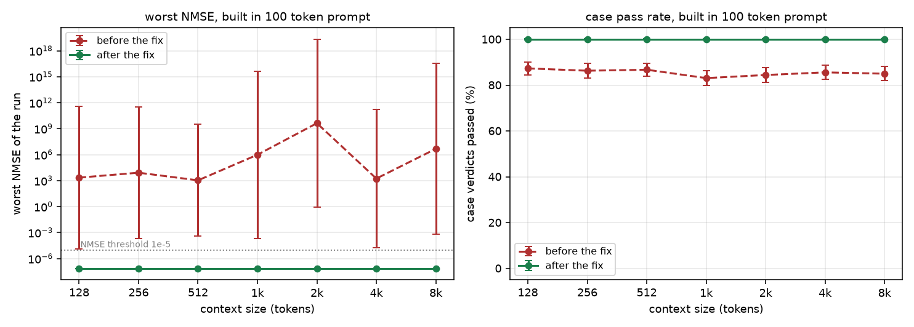
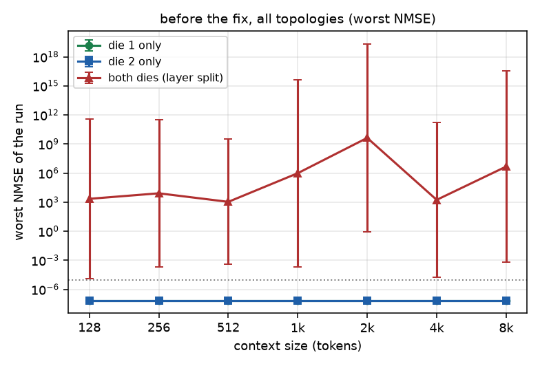
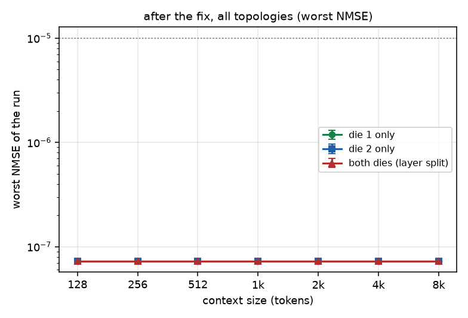
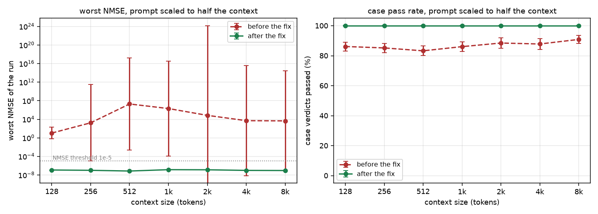
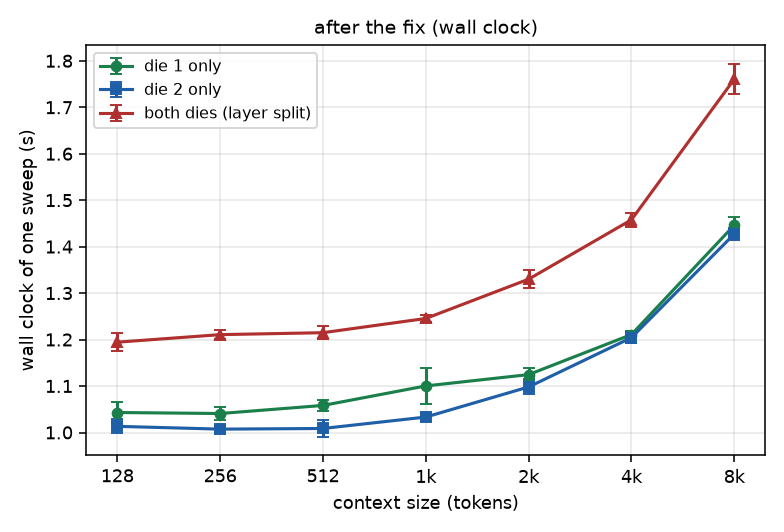

# Context size and device topology on the W6800X Duo: a Vulkan state-reproducibility study

This is the measurement behind the fix in `ggml-vulkan: stop cross-device copies from
sharing a staging buffer`. It answers one question: does `test-llama-context` stay
reproducible as the context grows, on each die alone and on both dies together?

Short answer: after the fix, yes, at every size from 128 to 8192 tokens, and on both
dies it is bit identical to a single die. Before the fix, both dies together were wrong
at every size, while either die alone was clean at every size. The defect was driven by
the device topology, not by the context size.

## Method

`test-llama-context` from `tests/llama-context/` runs 13 state cases per model and
asserts that a restored KV state reproduces the logits of the run that saved it. The
measured quantity is the NMSE those cases report against the saved baseline.

| axis | values |
|---|---|
| topology | die 1 only (`GGML_VK_VISIBLE_DEVICES=1`), die 2 only (`=2`), both dies layer split (`=1,2`) |
| context size | 128, 256, 512, 1024, 2048, 4096, 8192 |
| prompt | built in (100 random tokens), and scaled (about half the context) |
| repetitions | 5 per cell (105 runs per sweep) |
| models | 8 generated models, 4 decoding at a time (`-j 4`) |
| state | before the fix (commit `ebb73a303`), after the fix |

Two prompt settings are used on purpose. The scaled prompt makes a bigger context mean
more occupied cells, a larger KV state and more rows in the attention, so the sweep
exercises capacity and not only an allocation. The built in prompt keeps the work per
graph identical across context sizes, which separates "the context is bigger" from "the
run does more work".

Error bars are 95% intervals. For the worst NMSE of a run the values are averaged on a
log10 scale and the interval is a Student t interval over the 5 repetitions. For the pass
rate the interval is a Wilson score interval over the case verdicts. A bar of zero width
is a result, not a missing measurement: those repetitions produced bit identical numbers.

Commands:

```
cd logs/ctx-sweep
python3 ctxsweep.py --label post-short  --csv post-short.csv  --prompt-ratio 0
python3 ctxsweep.py --label post-scaled --csv post-scaled.csv --prompt-ratio 0.5
python3 analyze2.py pre-short.csv post-short.csv pre-scaled.csv post-scaled.csv
```

The raw per run data is in `data/`, the scripts in `scripts/`.

## Results

### Both dies, before and after (built in prompt)



| context | pass rate before | pass rate after |
|---|---|---|
| 128 | 87.3 +/- 2.9 % | 100.0 +/- 0.4 % |
| 256 | 86.3 +/- 3.3 % | 100.0 +/- 0.4 % |
| 512 | 86.7 +/- 2.9 % | 100.0 +/- 0.4 % |
| 1024 | 83.1 +/- 3.2 % | 100.0 +/- 0.4 % |
| 2048 | 84.4 +/- 3.1 % | 100.0 +/- 0.4 % |
| 4096 | 85.6 +/- 3.0 % | 100.0 +/- 0.4 % |
| 8192 | 85.0 +/- 3.1 % | 100.0 +/- 0.4 % |

Before the fix, every context size from 128 to 8192 failed: 4 or 5 of the 5 repetitions
in every cell had failing cases, and the worst NMSE of a run reached 6e15, which is a
logit vector that has nothing to do with the reference. The error bars are huge because
how much damage a run took depended on how the four workers happened to interleave; the
interval around 2048 reaches 2e19 even though no single run went that far.

After the fix every cell is 100 %, and the worst NMSE is 7.29e-08 with a zero width
interval in every repetition, so the four workers agree bit for bit.

### All topologies, before and after





The two green and blue curves lie exactly on top of each other, because a run on die 1
and a run on die 2 produce bit identical results. Only the layer split over both dies was
affected.

The worst NMSE per context size, identical on die 1, on die 2 and (after the fix) on both
dies, for the scaled prompt:

| context | worst NMSE (all topologies, after the fix) |
|---|---|
| 128 | 1.18e-07 |
| 256 | 1.02e-07 |
| 512 | 7.10e-08 |
| 1024 | 1.40e-07 |
| 2048 | 1.32e-07 |
| 4096 | 9.73e-08 |
| 8192 | 9.15e-08 |

The value wanders slightly with the context because the prompt changes with it, and it
stays two orders of magnitude below the 1e-5 threshold the test uses. The important part
is that the three topologies give the same number to the last printed digit: splitting a
model over two devices no longer changes the result.

### Scaled prompts (half the context)



| context | prompt tokens | pass rate before | pass rate after |
|---|---|---|---|
| 128 | 67 | 86.2 +/- 3.0 % | 100.0 +/- 0.4 % |
| 256 | 135 | 85.2 +/- 3.1 % | 100.0 +/- 0.4 % |
| 512 | 269 | 83.3 +/- 3.2 % | 100.0 +/- 0.4 % |
| 1024 | 540 | 86.1 +/- 3.3 % | 100.0 +/- 0.4 % |
| 2048 | 1082 | 88.5 +/- 3.6 % | 100.0 +/- 0.4 % |
| 4096 | 2166 | 87.8 +/- 3.6 % | 100.0 +/- 0.4 % |
| 8192 | 4331 | 90.5 +/- 2.8 % | 100.0 +/- 0.4 % |

Same conclusion with a much larger working set: the failure is not a capacity problem. A
state of 4331 tokens saves and restores exactly on both dies, and a state of 67 tokens did
not before the fix.

### Wall clock



One sweep of 8 models takes 1.01 s to 1.45 s on a single die and 1.19 s to 1.76 s on both
dies, so the layer split costs about 20 % at the largest size. That extra time is the
crossing at every layer boundary, which is the code path the patch changed.

### Additional stress, after the fix

| stress | result |
|---|---|
| context 16384, both dies, built in prompt | 8 of 8 models pass, 2 runs |
| `-j 8` at context 4096, both dies | 8 of 8 models pass, 2 runs |
| `-n 128` (128 generated tokens) at context 4096, both dies | 8 of 8 models pass, 3 runs, worst NMSE 1.60e-07 identical in all three |

## Row split is not available on Vulkan

`-sm row` fails for every model at every context size, and the reason is in the loader,
not in the state code:

```
E llama_model_load: error loading model: device Vulkan0 does not support split buffers
```

The Vulkan backend cannot split a tensor across two devices, so it refuses the model
instead of computing something wrong. That is a capability gap, it is independent of the
context size and of this patch, and it is the reason the row split topology has no series
in the charts. `data/post-row.csv` keeps the measurement.

## Limitations

- The models are the generated test models, a few MB each, not production weights. They are
  small enough that the whole KV cache fits comfortably in VRAM at 16384 tokens, so no
  pressure-induced fallback is exercised.
- 5 repetitions per cell puts a wide interval on the pass rate, about +/- 3 points. That
  is enough to separate 100 % from 85 % and not enough to resolve smaller differences.
- The two dies are two chips of one W6800X Duo MPX module, so both "single die" series
  describe the same silicon. Two separate cards could behave differently.
- The box logs correctable and once an uncorrectable PCIe error on the duo's first die,
  and one parallel `ctest` run was aborted by a GPU reset. Runs that overlapped that event
  are not part of this data; the sweeps here ran one at a time.
- Reproducibility is asserted against a baseline computed in the same process and the same
  configuration. These numbers say nothing about agreement with a different backend or a
  different build. The follow-up study in `../macpro71fedora-backends/` measures that part
  for the whole machine, with KL divergence against CPU logits and with the CPU and ROCm
  topologies added beside the two Vulkan dies.
